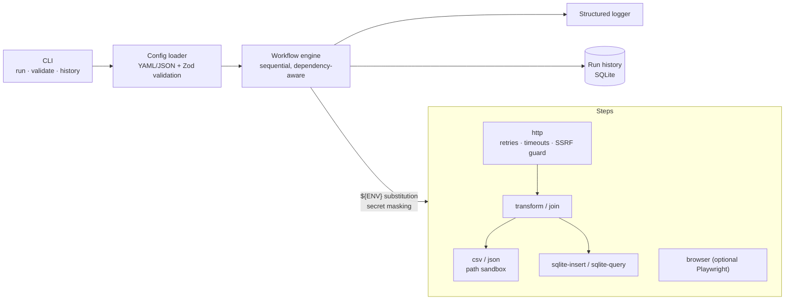

# FlowBridge

A configurable automation toolkit: describe a workflow in YAML or JSON, and FlowBridge fetches data from REST APIs, validates and reshapes it, writes CSV/JSON, stores it in SQLite, and can drive a browser — with retries, structured logs, run history, and safe defaults.

> Portfolio project. All data is synthetic or comes from the public demo API [JSONPlaceholder](https://jsonplaceholder.typicode.com). No customer data, credentials, benchmarks, or client results are included.

## What problems it solves

| Need | FlowBridge step(s) |
| --- | --- |
| Pull records from a REST API into a spreadsheet | `http` → `csv` |
| Clean, validate and reshape API data | `http` → `transform` → `json` / `csv` |
| Combine several endpoints into one report | `http` + `http` → `join` → `csv` |
| Persist data and report on it | `sqlite-insert` → `sqlite-query` → `csv` |
| Automate a web form (optional) | `browser` |
| Know what ran and why it failed | execution history + structured logs |

## Implemented vs. planned

| Feature | Status |
| --- | --- |
| YAML/JSON workflows with strict validation | ✅ implemented |
| `http` step (GET/POST, headers, query, bearer/basic/header auth via env vars, timeouts, bounded retries, redirects re-validated) | ✅ |
| `transform` step (nested paths, defaults, required fields, coercion, filters, limit) | ✅ |
| `csv` / `json` outputs (field selection, header renaming, formula-injection guard) | ✅ |
| `join` step (combine two datasets) | ✅ |
| `sqlite-insert` / `sqlite-query` (parameterised, transactional, read-only queries) | ✅ |
| `browser` step (Playwright, optional install, local fixture demo) | ✅ |
| Structured JSON logs, secret masking, exit codes | ✅ |
| Execution history (SQLite) + `history` command | ✅ |
| Scheduled execution (cron-style) | ⏳ planned |
| Other databases (Postgres/MySQL) | ⏳ planned |
| Pagination helpers, OAuth2 client-credentials flow | ⏳ planned |
| Custom user-defined steps / plugin loading | ⏳ planned (steps are registered in one place, see below) |
| Web dashboard | ❌ out of scope |

## Architecture



Boundaries:

1. **Configuration** (`src/config.ts`): parse + validate before anything runs. Unknown keys, bad references and unsafe identifiers fail here, with every problem listed.
2. **Execution** (`src/engine.ts`): runs steps in order, passes each step's output to later steps by `id`, stops on failure (or skips dependants with `continueOnError`).
3. **Steps** (`src/steps/*`): each exports a Zod schema and a run function. To add a step: write its schema + function, then register it in `stepSchemas` (`src/config.ts`) and the `dispatch` switch (`src/engine.ts`).
4. **Shared safety** (`src/lib/*`): URL policy, path sandbox, env interpolation, redacting logger.

## Prerequisites and installation

- Node.js ≥ 22.13 (developed on 24). SQLite uses Node's built-in `node:sqlite`, so there is no native module to compile.
- npm.

```bash
npm install
npm run build        # optional; `npm run cli -- ...` runs from source
```

## Running a workflow

```bash
npm run cli -- run workflows/api-to-csv.yaml
# or, after building:
node dist/cli.js run workflows/api-to-csv.yaml
```

Commands: `run <file>`, `validate <file>`, `history`. Options: `--root <dir>`, `--allow-private-network`, `--json-logs`, `--verbose`, `--history-db <file>`, `--no-history`.

**Exit codes:** `0` success · `1` a step failed · `2` invalid configuration or usage.

### Example: API → CSV

```yaml
name: api-to-csv
version: 1
steps:
  - id: fetch-users
    type: http
    method: GET
    url: https://jsonplaceholder.typicode.com/users
  - id: export-users
    type: csv
    input: fetch-users
    output: ./output/users.csv
    fields:
      - name
      - email
      - { path: company.name, header: company }   # nested path, custom header
```

Console output:

```
✓ Running "api-to-csv" (3 steps)
✓ [fetch-users] http: GET https://jsonplaceholder.typicode.com/users -> 200, 10 records ms=1085
✓ [export-users] csv: 10 rows -> ./output/users.csv ms=3
✓ Workflow succeeded: 3/3 steps in 1090ms
```

`output/users.csv` (first rows, with the default header `company.name` if you omit `header`):

```
name,email,company.name
Leanne Graham,Sincere@april.biz,Romaguera-Crona
Ervin Howell,Shanna@melissa.tv,Deckow-Crist
```

## Demonstrations

Every example below is reproducible from a fresh clone.

| Command | What it shows | Needs |
| --- | --- | --- |
| `npm run demo:offline` | API → transform (filter, defaults) → CSV against a bundled mock server | nothing external |
| `npm run demo:csv` | The example above against the live demo API; also writes `output/users.json` | internet |
| `npm run demo:db` | Fetch two endpoints → store in SQLite → "posts per author" report CSV | internet |
| `npm run demo:browser` | Fill + submit a local form, extract the confirmation → `output/browser-result.json` | Playwright (see below) |

### Database workflow

`workflows/api-to-sqlite-report.yaml` creates `output/flowbridge-demo.db` on first run. Tables are created explicitly from the `columns` block (`CREATE TABLE IF NOT EXISTS`), records are validated and typed before insert, and the batch is one transaction. Records need not share fields: missing values become `NULL` unless marked `required`. Sample data comes from the public API (or `fixtures/*.json` through the mock server). Inspect the result with `sqlite3 output/flowbridge-demo.db`.

`sqlite-query` opens the database **read-only** and accepts only `SELECT`/`WITH`; use `?` placeholders with `params`. FlowBridge only touches database files inside `--root`.

### Browser automation (optional)

API workflows never load Playwright. For browser steps:

```bash
npm install playwright            # already a dev dependency in this repo
npx playwright install chromium   # downloads a browser binary
npm run demo:browser
```

To reuse a Chromium you already have, set `FLOWBRIDGE_BROWSER_EXECUTABLE=/path/to/chromium`. The step opens a `file:` page inside `--root` (or an `http(s)` URL that passes the URL policy), blocks requests to any other origin, and supports `fill`, `select`, `check`, `click`, `waitFor`, `extract`. It does not and will not attempt to bypass CAPTCHAs or access controls; point it only at pages you are allowed to automate.

## Configuration reference (short)

- **Secrets:** use `${VAR}` anywhere in a step, or `auth: { type: bearer, tokenEnv: API_TOKEN }`. Values come from the environment or a local `.env` (copy `.env.example`; never commit `.env`).
- **`http`:** `method` (GET/POST), `url`, `query`, `headers`, `body`, `auth`, `dataPath`, `timeoutMs` (default 10 000), `retries` (GET only, default 2, max 5), `maxResponseBytes`.
- **`transform`:** `path`, `where`, `select` (`out: path` or `{from, default, required, as}`), `onInvalid` (`error`|`skip`), `limit`.
- **`csv` / `json`:** `input`, `output`, `fields` (`path` or `{path, header}`); csv also `delimiter`, `sanitizeFormulas`.
- **`join`:** `input`, `with`, `on: {left, right}`, `kind` (`left`|`inner`), `rightPrefix`.
- **`sqlite-insert`:** `input`, `database`, `table`, `columns`, `onConflict` (`fail`|`ignore`|`replace`), `onInvalid`.
- **Any step:** `continueOnError`.

## Error handling

- Configuration errors list every problem with its location (`steps.1.input: ...`) before any request is made.
- HTTP: timeouts, network errors and HTTP errors are distinguished; 408/425/429/5xx and network failures are retried with exponential backoff and jitter (honouring `Retry-After`, capped). Other 4xx fail immediately. POST is never retried.
- Malformed JSON, a missing `dataPath`, missing required fields, invalid column types, database and browser failures each produce a step-level error with a code (`HTTP_TIMEOUT`, `DATA_INVALID`, `DB_ERROR`, …).
- A failed step stops the workflow; later steps are reported as `skipped`. Nothing is silently written from partial data (SQLite batches are all-or-nothing).
- Every run is recorded in `.flowbridge/history.db`; view with `npm run cli -- history`.

## Security considerations

Implemented safeguards:

- **SSRF:** only `http(s)`; no URL credentials; hostnames are resolved and loopback/private/link-local/reserved addresses (including IPv4-mapped IPv6) are rejected unless `--allow-private-network` is passed. Redirects are followed manually and each hop is re-checked; `Authorization`/cookie headers are dropped on cross-origin redirects.
- **Path traversal:** all output files, databases and local browser pages must stay inside `--root` (default: current directory); `..`, absolute paths and symlink escapes are rejected.
- **Secrets:** read from environment variables, masked in console/JSON logs and stored history, and sensitive URL query parameters are redacted.
- **SQL:** parameterised values, identifiers restricted to `[A-Za-z0-9_]`, queries run on a read-only connection.
- **CSV injection:** cells beginning with `= + - @` are prefixed with `'` (disable with `sanitizeFormulas: false`).
- **Resource limits:** request timeout and maximum response size.

Known limitations (not a claim of complete security): DNS is resolved separately from the connection, so DNS rebinding is not fully prevented; workflow files are trusted input (they can read any environment variable via `${VAR}`), so only run workflows you trust; the browser step's origin blocking covers requests inside the page but is not a sandbox against a hostile page.

## Testing

```bash
npm run typecheck
npm test                 # offline: local servers, temp dirs, no external services
npm run build
npm run check            # all three
```

Tests cover config validation, HTTP success/failure/timeouts/retries/redirects, SSRF and path-traversal blocking, transforms with missing and nested fields, CSV/JSON output, SQLite persistence and rollback, engine failures, history, and the CLI end to end. Real-browser tests run only if Chromium can be launched (otherwise they are skipped and reported as such); to force them: `FLOWBRIDGE_BROWSER_EXECUTABLE=... npm test`.

## Directory structure

```
src/
  cli.ts            command-line entry point
  config.ts         schema registry + workflow validation
  engine.ts         sequential executor
  history.ts        run history (SQLite)
  steps/            http · transform · join · output(csv,json) · sqlite · browser
  lib/              errors · fields · env · logger · safe-path · url-policy
scripts/            mock-server.ts, offline-demo.ts
workflows/          example workflows
fixtures/           synthetic users/posts + local HTML form
tests/              Vitest suites
```

## Current limitations

- Steps run sequentially; no parallelism, no scheduling yet.
- Only JSON responses are parsed; no pagination helper.
- One SQLite file format; no other databases yet.
- The linter is not configured; correctness checks are strict `tsc` plus tests.
